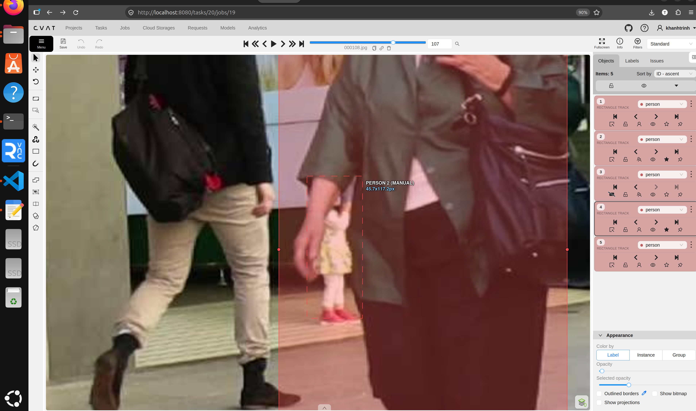
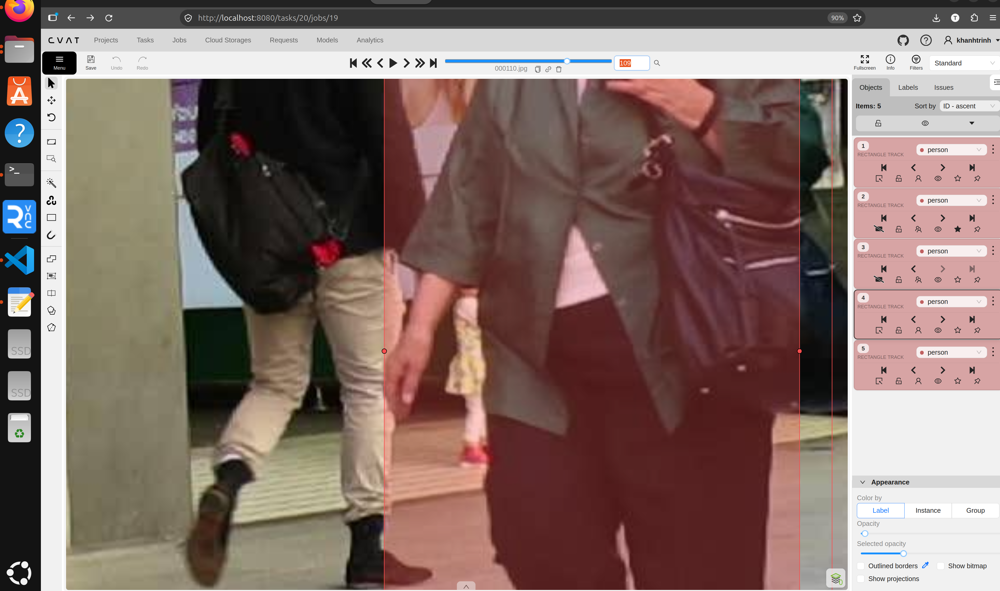
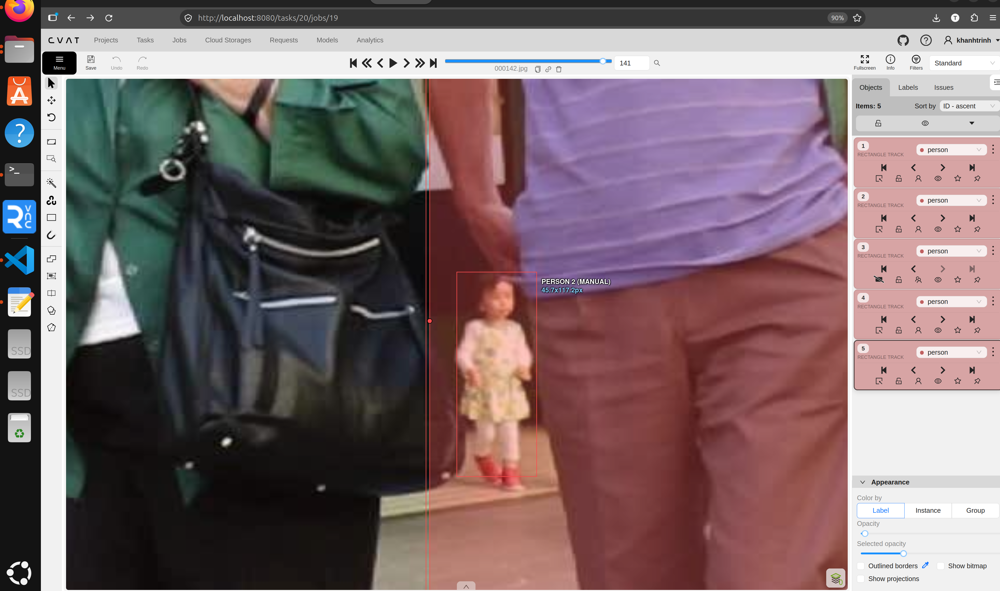

# Báo cáo cá nhân — HoVaTen-MSSV

Đổi tên file theo quy tắc `MSSV_HoTen.md`. Ví dụ: `20241234_NguyenVanAn.md`.

Đoạn video: MOT17-09, 150 frame (frame 1–150), nguồn MOTChallenge, giấy phép CC BY-NC-SA 3.0.

## 0. Thông tin học viên

- Họ tên: Trịnh Vinh Khánh
- MSSV: 2A202603220
- Mã đề (A/B/C): B
- Email: 26ai.khanhtv2@vinuni.edu.vn
- Link repository: https://github.com/ks1610/K5-L2-DAY05-TrinhVinhKhanh-2A202603220-MOTTracking
- Giờ bắt đầu: 16:00
- Giờ kết thúc: 18:30

## 1. Xem trước đoạn video (CP0)

Ghi **trước khi vẽ**, mỗi người một dòng.

| Mã | Frame xuất hiện | Frame cuối thấy được | Rẽ / dừng / đổi tốc độ ở frame | Bị che ở frame | Ghi chú |
|---|---|---|---|---|---|
| P1 | 0 | 149 | Rẽ ở frame 25, đổi tốc độ ở frame 77  | 39  | Đối tượng là người đàn ông mặc áo đen trong cửa hàng |
| P2 | 0 | 145 | Dừng ở frame 30 | 109, 146 | Đôi tượng là đứa trẻ |
| P3 | 0 | 104 | Dừng ở frame 24 | 105 | Đối tượng là người phụ nữ đi cùng đứa trẻ |
| P4 | 0 | 149 | không | không | đối tượng là người phụ nữ lớn tuổi mặc áo xanh lá cây |
| P5 | 12 | 149 | không | không | đối tượng là người đàn ông lớn tuổi mặc áo xanh dương |

## 2. Keyframe và thời gian (CP1, CP4)

Số keyframe lấy từ kết quả `src/check_submission.py`.

| Mã | Số keyframe | Keyframe ở frame | Số frame có mặt | Keyframe / 100 frame | Thời gian (phút) | Chỗ khó |
|---|---:|---|---:|---:|---|---|
| P1 | 61 | 0, 7, 8, 10, 11, 12, 13, 14, 17, 22, 28, 29, 30, 31, 32, 34, 52, 56, 57, 61, 62, 63, 65, 66, 67, 68, 69, 71, 74, 78, 79, 80, 81, 83, 85, 86, 87, 88, 90, 93, 95, 96, 99, 100, 103, 111, 112, 113, 114, 115, 116, 117, 118, 119, 124, 125, 128, 135, 137, 143, 147 | 137 | 44.5 |    |  |
| P2 | 16 | 0, 3, 8, 23, 28, 51, 107, 129, 136, 137, 138, 139, 140, 142, 143, 144 | 120 | 13.3 |   |  |
| P3 | 7 | 0, 11, 19, 37, 38, 96, 103 | 105 | 6.7 |   | |
| P4 | 24 | 0, 4, 19, 29, 44, 48, 53, 61, 72, 73, 76, 80, 84, 90, 98, 101, 107, 112, 119, 125, 134, 139, 144, 149 | 150 | 16.0 |   |   |
| P5 | 21 | 12, 25, 33, 44, 52, 58, 66, 80, 88, 94, 100, 105, 111, 119, 125, 130, 135, 140, 144, 145, 149 | 138 | 15.2 |   |  |

Bạn đặt keyframe nhiều nhất ở người nào? Vì sao (người đó rẽ, dừng, lại gần camera hay bị che)?

```
- Keyframe được đặt nhiều nhất ở person 1 (Đối tượng là người đàn ông mặc áo đen trong cửa hàng)
- Nguyên nhân: Đối tượng có nhiều chuyển động nhất, bao gồm rẽ ở frame 25, đổi tốc độ ở frame 27 và bị che ở frame 39, 
```

## 3. Đoạn bị che (CP2)

Người bị che: `P2`

| Mốc | Frame |
|---|---:|
| Bắt đầu bị che một phần (bật `occluded`) | 107 |
| Mất hẳn (bật `outside`) | 109 |
| Hiện lại (tắt `outside`) | 136 |
| Thấy rõ trở lại (tắt `occluded`) | 141 |

- Thời gian khuất hẳn: `27` frame = `0.9` giây.
- Quyết định: `giữ cùng ID .`
- Lý do (trả lời 3 câu: khuất bao lâu so với 60 frame, ngoại hình có khớp, chỗ hiện lại có đúng hướng và tốc độ):
```
Lý do: 
- Thời gian khuất: 27 frame (0.9 giây), nhỏ hơn ngưỡng 60 frame (2 giây) của lớp.
- Ngoại hình khớp với chỗ hiện tại đứng.
- Chỗ hiện tại cùng hướng với trước khi bị che.
```
...

Ảnh chụp màn hình:





## 4. Tự review ID (CP3)

Lượt 1 theo người (đi ngược từ frame 149 về 0 trên CVAT), lượt 2 theo cảnh (nhảy 10 frame). Ít nhất 3 dòng; không có lỗi thì ghi một dòng "đã kiểm hai lượt, không lỗi".

Loại lỗi dùng đúng một trong 7 mã: `id_switch`, `fragmentation`, `lost`, `merge`, `false_track`, `drift`, `flag`.

| Frame | Mã người | Loại lỗi | Mô tả một câu | Phát hiện ở lượt | Đã sửa? |
|---:|---|---|---|---|---|
| 139 | p4 |  merge | Keyframe bị dè lên đối tượng p5| 1 | Chỉnh lại Keyframe đối tượng, kéo ra khỏi nguoief bị đè |
| 10 | p3 | false_track | Thừa box | 2 | Xóa box bị thừa |
| 46 | p1 | lost | Keyframe xuất hiện sớm | 2 | Bật auto save trong workspace, điều chỉnh tắt outside theu đúng thời điểm xuất hiện lại |

Tổng hợp số lỗi theo loại:

| `id_switch` | `fragmentation` | `lost` | `merge` | `false_track` | `drift` | `flag` |
|---:|---:|---:|---:|---:|---:|---:|
|  | | | | | | |

Lỗi nào chỉ lượt 2 (theo cảnh) mới thấy, lượt 1 (theo người) không thấy? Vì sao?

...

## 5. File xuất và kết quả tự kiểm (CP4)

| Kiểm tra | Kết quả |
|---|---|
| Tên file MOT 1.1 | TrinhVinhKhanh_mot.zip |
| Tên file CVAT for video 1.1 | TrinhVinhKhanh_cvat_video.zip |
| Số track ID khác nhau trong `gt/gt.txt` (phải là 5) | 5 ID (1, 2, 3, 4, 5) |
| Frame `outside` không có dòng trong `gt.txt` (đúng / sai) | Đúng |
| Job đã completed trên CVAT máy cá nhân | đã chuyển sang completed |

Dán phần tóm tắt in ra từ `src/check_submission.py`:

```text
Số frame in theo CVAT (bắt đầu từ 0). Trong gt.txt, frame_id = frame CVAT + 1.

=== File MOT 1.1: TrinhVinhKhanh_mot.zip ===
  Số track ID: 5   |   Tổng số box: 650
  [OK]        Đúng 5 track ID.

  Track | Frame có mặt | Số frame | Đoạn vắng (outside)
      1 |   0–149      |      137 | 39–51
      2 |   0–145      |      120 | 109–128, 130–135
      3 |   0–104      |      105 | -
      4 |   0–149      |      150 | -
      5 |  12–149      |      138 | -


=== File CVAT for video 1.1: TrinhVinhKhanh_cvat_video.zip ===

  Track | Nhãn   | Frame thấy | Keyframe | KF/100 frame | Frame occluded | Lần bật outside
      0 | person |        137 |       61 |         44.5 |              9 |               1
              Track 0: keyframe ở frame [0, 7, 8, 10, 11, 12, 13, 14, 17, 22, 28, 29, 30, 31, 32, 34, 52, 56, 57, 61, 62, 63, 65, 66, 67, 68, 69, 71, 74, 78, 79, 80, 81, 83, 85, 86, 87, 88, 90, 93, 95, 96, 99, 100, 103, 111, 112, 113, 114, 115, 116, 117, 118, 119, 124, 125, 128, 135, 137, 143, 147]
      1 | person |        120 |       16 |         13.3 |             11 |               3
              Track 1: keyframe ở frame [0, 3, 8, 23, 28, 51, 107, 129, 136, 137, 138, 139, 140, 142, 143, 144]
      2 | person |        105 |        7 |          6.7 |              9 |               1
              Track 2: keyframe ở frame [0, 11, 19, 37, 38, 96, 103]
      3 | person |        150 |       24 |         16.0 |              0 |               0
              Track 3: keyframe ở frame [0, 4, 19, 29, 44, 48, 53, 61, 72, 73, 76, 80, 84, 90, 98, 101, 107, 112, 119, 125, 134, 139, 144, 149]
      4 | person |        138 |       21 |         15.2 |             32 |               0
              Track 4: keyframe ở frame [12, 25, 33, 44, 52, 58, 66, 80, 88, 94, 100, 105, 111, 119, 125, 130, 135, 140, 144, 145, 149]

  Tổng: 129 keyframe / 650 frame có mặt = 19.8 keyframe / 100 frame
  [OK]        Đọc được 5 track từ annotations.xml.

=== Tóm tắt ===
  Lỗi: 0   |   Cảnh báo: 0
  Đạt. Dán phần tóm tắt này vào báo cáo mục 5.


```

## 6. Ba câu kết

1. Nếu được gán lại, bạn sẽ đặt keyframe khác ở đâu? Vì sao?

```
Giảm số lượng Keyframe cho đối tương P1. Diều này nhằm giúp giảm tài nguyên sử dụng và tăng tốc độ xử lý cho mô hình trên thiết bị.
```

2. Có chỗ nào bạn không chắc "cùng ID hay ID mới"? Bạn đã quyết định và ghi chú thế nào?

```
Với đối tượng P2, sau khi bị che ở frame 109, sau khi hiện lại, đối tượng có thể là một đối tượng khác. 
- Dựa vào các đặc chưng của đối tượng trước khi bị che như: quần áo, khuôn mặt, vóc dáng có thể xác định được vật có cùng id hay không
``` 

3. Một lỗi ID trong job của bạn (nếu không còn sót, chọn lỗi đã sửa) có thể làm xe tự lái dự đoán sai chuyển động của người đó như thế nào? Lỗi đó ảnh hưởng MOTA hay IDF1 nhiều hơn?

```
Với đối tượng P1, nếu không khắc phục lỗi lost khi Keyframe xuất hiện trước frame xuất hiện của đối tượng. Điều này khiến hệ thống nhận diện và theo dõi P1 ở một thời điểm mà thực tế chưa có người trong khung hình.

Điều này khiến xe tự lái tính toán sai thời gian xuất hiện của dối tượng để đưa ra các phản hồi thay đổi tốc độ, phanh. 

Lỗi ảnh huongử đến MOTA nhiều hơn vì các Keyframe xuất hiện sai thời điểm được tính là False Positive, làm tăng số lượng phát hiện sai.
```
## Bonus (nếu làm)

### B1 — Hai người đi sát

...

### B2 — So cách đặt keyframe

| Cách đặt | Số keyframe | Frame trôi nhất | Ghi chú |
|---|---:|---:|---|
| Đều mỗi 30 frame | | | |
| Theo chỗ đổi hướng | | | |

...

### B3 — So với tracker có sẵn

| Frame | Mã người | Tracker làm gì | Nhãn của bạn | Giải thích (đoán rồi sửa / ghép IoU / box score thấp / ngoại hình) |
|---:|---|---|---|---|
| | | | | |
| | | | | |

## 7. Tài liệu tham khảo và công cụ AI đã dùng

...
